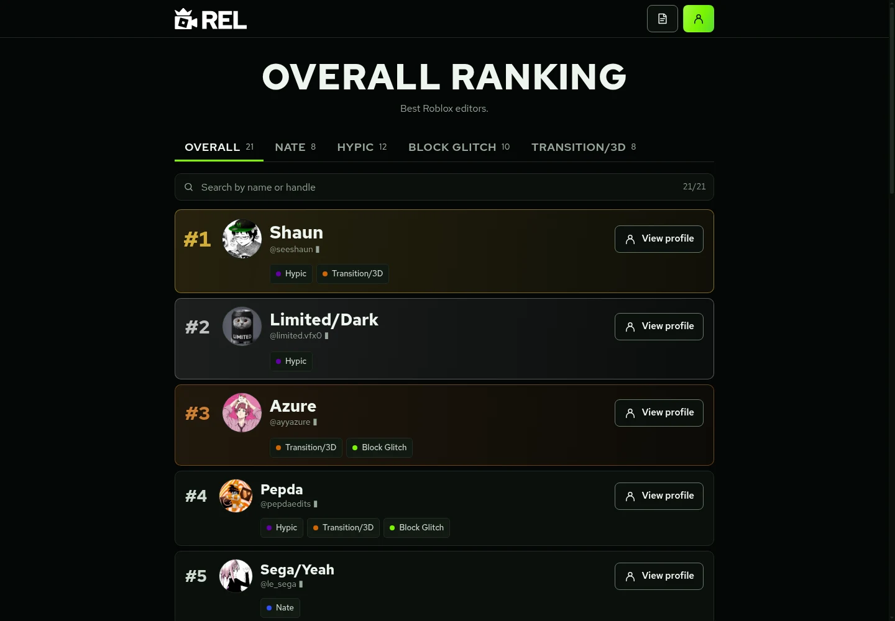
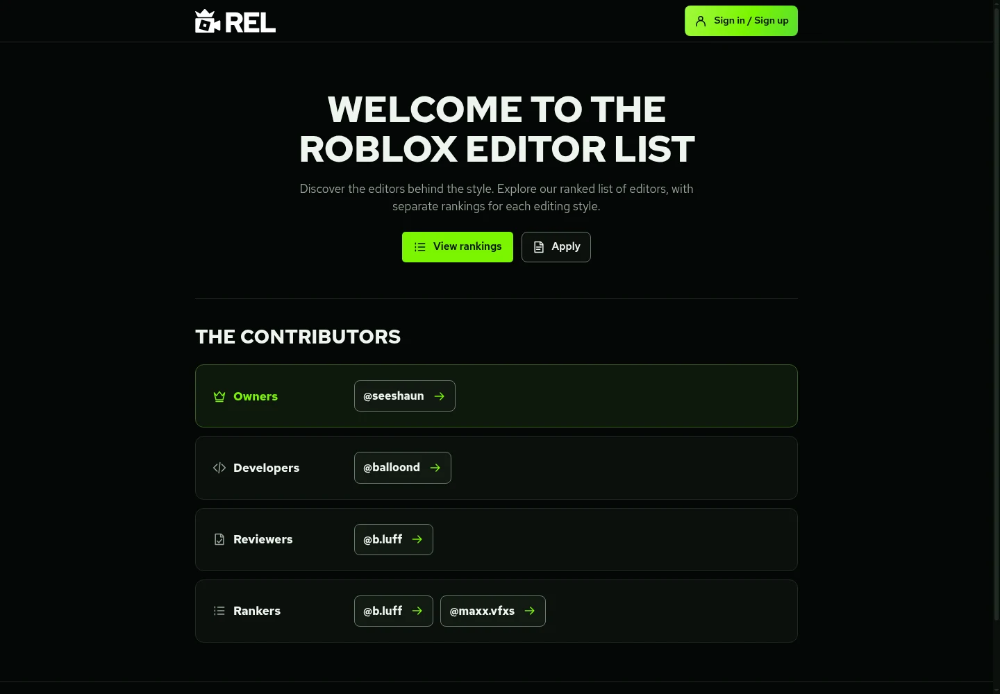
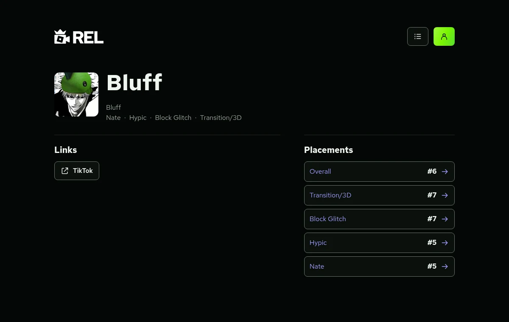
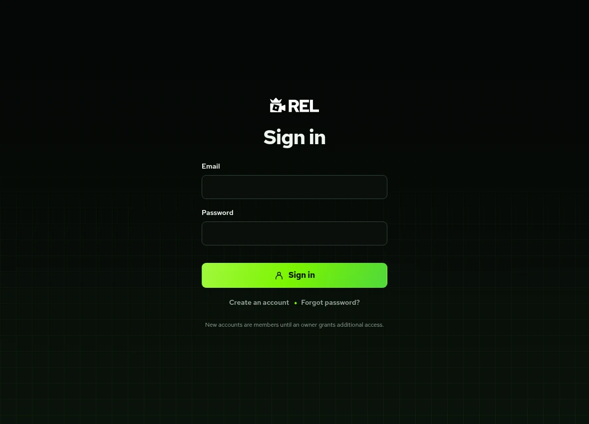
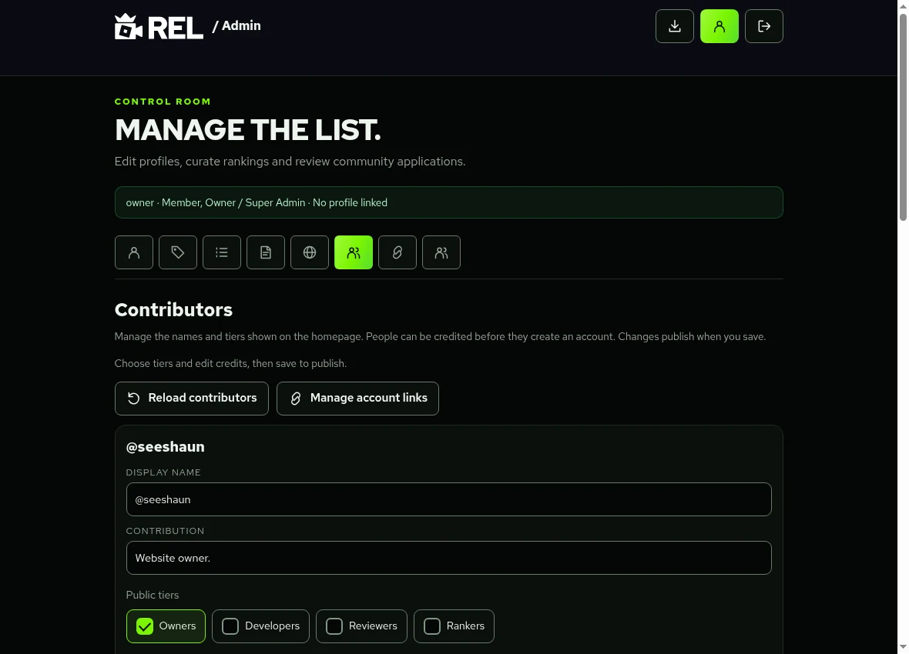
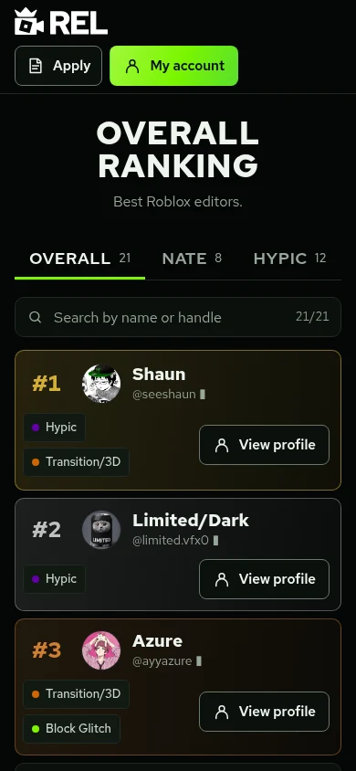
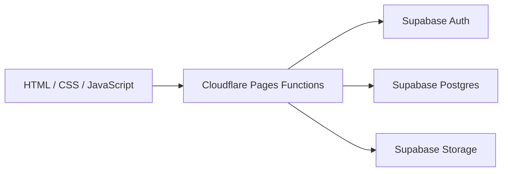

<h1 align="center">Roblox Editors List</h1>

<p align="center">Rankings and profiles for the Roblox editing community.</p>

<p align="center">
  <a href="https://robloxeditors.com"><strong>Visit REL</strong></a> ·
  <a href="https://robloxeditors.com/list/">View rankings</a> ·
  <a href="#how-rel-works">How it works</a> ·
  <a href="docs/README.md">Developer docs</a>
</p>

[](https://robloxeditors.com/list/)

REL is a community ranking website for Roblox video editors, with an overall list and separate lists for editing styles. Beyond the rankings, it connects public editor profiles, verified accounts, application reviews and the staff tools used to maintain the site.

The interface uses HTML, CSS and JavaScript. Cloudflare Pages Functions handle the API, with Supabase providing authentication, Postgres and picture storage.

## Explore the website

- **Browse by editing style.** Switch between Overall, Nate, Hypic, Block Glitch and Transition/3D, or search for an editor by name or handle.
- **Compare channel audiences.** The development version adds a separate Popularity list for ranked editors with confirmed TikTok or YouTube connections, showing follower/subscriber snapshots and update dates. [Preview and setup](docs/POPULARITY.md).
- **Join a clan.** The development version adds invite-based clans with creator-set four-character prefixes and member rankings. Joining requires confirmation. [Preview and guide](docs/CLANS.md).
- **Open a profile.** See an editor's list placements, links, software and any published showcase. Accounts and contributor credits have shareable profiles too.
- **Manage your own details.** Create and confirm an account, then request an Owner-verified link to your editor profile. That link gives access to your details without granting ranking permissions.
- **Help maintain REL.** Staff permissions separate ranking edits, application reviews and Owner account management. Public contributor tiers credit Owners, Developers, Reviewers and Rankers.

## Take a closer look

Expand a section to see that part of the website. Public screenshots use a read-only snapshot of REL's public data; the staff screenshot uses the isolated development fixture. [Screenshot notes](docs/images/README.md).

<details>
<summary><strong>The homepage and the people behind REL</strong></summary>

The homepage introduces the list, links to applications and groups contributors by their public role. Each contributor links to a profile, including people who have not registered an account.



</details>

<details>
<summary><strong>Profiles that connect editors, accounts and placements</strong></summary>

Profile URLs use stable IDs so renaming an editor or account does not change their link. Editor pages bring placements and public links together; an Owner verifies the connection between an account and an existing editor.



</details>

<details>
<summary><strong>Accounts, confirmation and password recovery</strong></summary>

Supabase Auth handles email/password accounts. New accounts start as Members and must confirm their email before signing in. Recovery uses an emailed code; confirming an account does not grant staff permissions.



</details>

<details>
<summary><strong>The staff side: editing contributor credits</strong></summary>

Owners manage credited names, descriptions, ordering, visibility and public tiers. Public credits and account permissions are separate: appearing under a tier does not grant staff access.

This screenshot uses a fictional Owner account in the local test fixture. It does not show private production account or application records.



</details>

<details>
<summary><strong>The rankings on a phone</strong></summary>

The layout reflows for smaller screens, with scrollable style tabs and visible action labels on touch devices.

<p align="center">
  
</p>

</details>

## How REL works



The browser loads the pages and calls same-origin `/api/` endpoints for data and account actions. Functions validate requests and verify the current account. Database functions check roles and ownership again before protected operations. Session tokens stay in HttpOnly cookies, and public profiles exclude emails, account permissions and private review records.

### Editing without overwriting someone else's work

Ranking saves include the revision that staff originally loaded. If two people edit the same list, the first save advances that revision and the second receives a conflict instead of overwriting it. Successful saves keep the previous document in private history and record the account responsible for the change.

### Reviewing applications separately from rankings

Applications contain an editor's profile, styles and example work. Reviewers approve or reject pending submissions with a private reason and recorded reviewer attribution. Decisions are locked afterward. Approval alone does not change the rankings; a List Contributor must separately add the approved editor through the staff workflow.

## Read the implementation

| What you want to understand | Start here |
| --- | --- |
| Ranking filters, search and editor details | [`list/index.html`](list/index.html) |
| Public profile rendering and data | [`assets/public-profile.js`](assets/public-profile.js), [`functions/api/profiles.js`](functions/api/profiles.js) |
| TikTok account ownership confirmation | [`assets/tiktok-connection.js`](assets/tiktok-connection.js), [setup and verification](docs/TIKTOK_CONNECTION.md) |
| Popularity and YouTube authorisation | [`popularity/index.html`](popularity/index.html), [`functions/api/popularity.js`](functions/api/popularity.js), [setup and previews](docs/POPULARITY.md) |
| Clans, prefixes and invitations | [`assets/clans.js`](assets/clans.js), [`functions/api/account/clans.js`](functions/api/account/clans.js), [clan guide](docs/CLANS.md) |
| Sessions, verified accounts and permissions | [`functions/_auth.js`](functions/_auth.js), [`supabase/auth-roles.sql`](supabase/auth-roles.sql) |
| Application submission and staff review | [`functions/api/applications.js`](functions/api/applications.js), [`functions/api/applications/admin.js`](functions/api/applications/admin.js) |
| Ranking saves and conflict handling | [`functions/api/save.js`](functions/api/save.js), [ranking preservation guide](docs/RANKING_STORAGE.md) |
| Contributor tiers and Owner editing | [`assets/contributors.js`](assets/contributors.js), [`assets/contributors-admin.js`](assets/contributors-admin.js) |
| Security, privacy and optional video loading | [Review and release requirements](docs/SECURITY_REVIEW.md), [`assets/video-consent.js`](assets/video-consent.js) |
| Application tracking, notifications and YouTube authorisation | [Implementation and release guide](docs/APPLICATION_TRACKING_AND_YOUTUBE.md) |
| Isolated account and database tests | [`tests/`](tests/), [development guide](docs/DEPLOY_AND_TEST.md) |

## Try the development version

Use Node.js 22 or later; REL is checked with Node.js 24.

```sh
npm ci
npm test
npm run build
npm run test:preview
```

The preview starts an isolated site on loopback port `8789` with fictional accounts and rankings. It needs no production credentials and sends no emails. Try `owner@example.test` or `member@example.test` with the fixture password `test-password-123`; restart the fixture to discard edits.

The build writes static files to `dist/`. `npm run check:cloudflare` compiles the Functions without deploying. See the [development guide](docs/DEPLOY_AND_TEST.md) for the other test roles, real Functions, browser checks and separate Supabase test-project setup.

## What is still being developed

This development branch combines account-required applications, applicant status, submission/decision emails, private archives, social ownership verification, popularity rankings and clans. Provider configuration, ordered SQL prerequisites and approved live checks remain necessary before release. See the [combined branch review](docs/COMBINED_BRANCH.md).

New environments also need the SQL prerequisites for accounts, public profiles, [contributor editing](docs/CONTRIBUTOR_TIERS.md) and [request limits](docs/SECURITY_REVIEW.md#required-release-order). The request-limit migration must be applied before releasing the dependent website code. Real email delivery and provider abuse controls need verification in the intended environment; the local fixture cannot prove those settings.

## Working on REL

Read the [documentation index](docs/README.md) and [contribution guide](CONTRIBUTING.md). New work starts on a branch from the latest `origin/main`. Production deploys from `main` through Cloudflare Pages after the owner's approval.

Preserve editor rankings and `data.js`. Website builds do not initialize the live database or apply migrations. Keep credentials and private backups out of Git, and use the isolated fixture for fictional edits.
