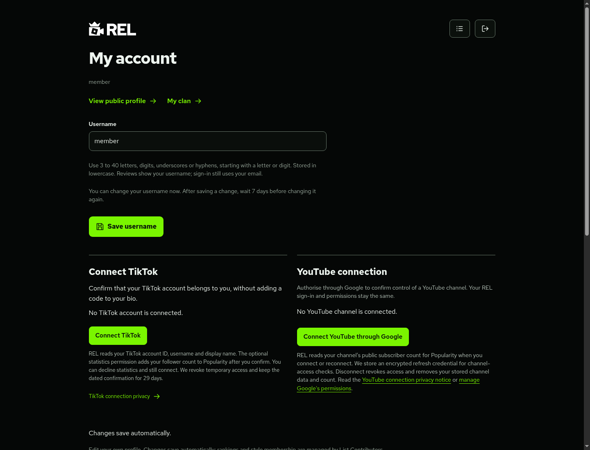
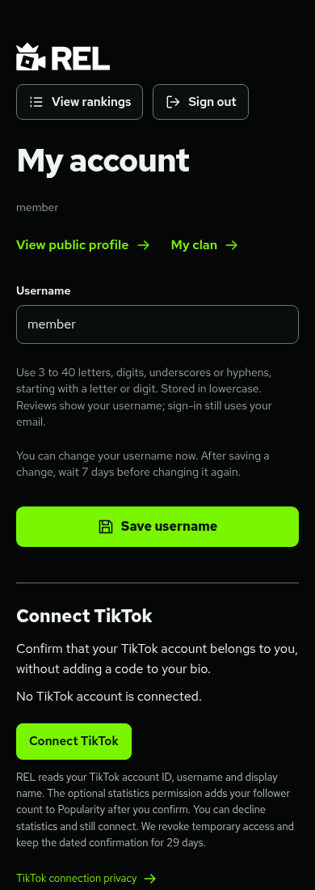
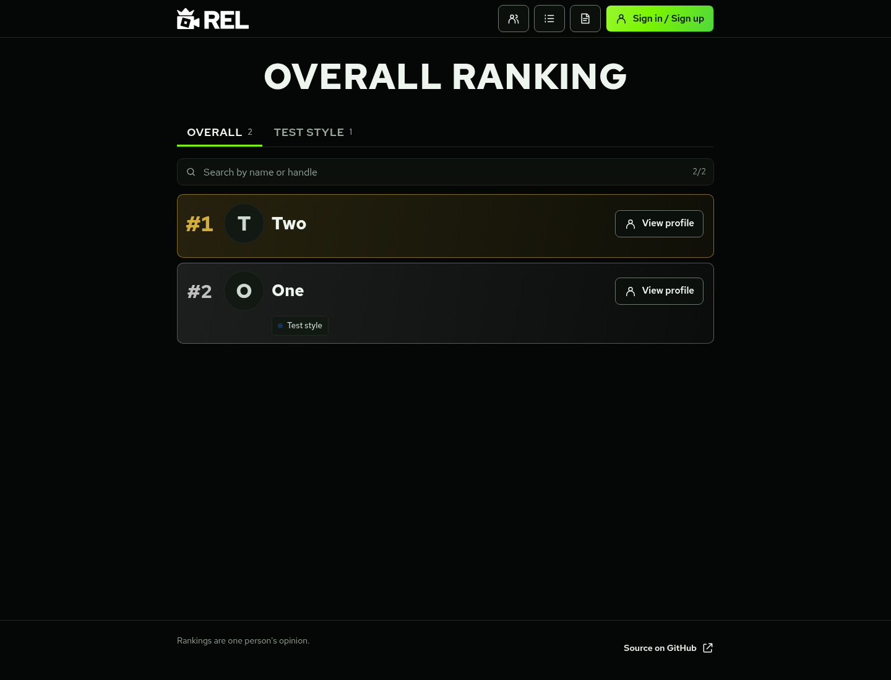

# Account layout and navigation fixes

The dashboard now has a scoped width of up to 1040px instead of inheriting the sign-in form's 420px width. Profile fields use two columns above 560px; TikTok and YouTube panels sit side by side at 960px and above, then stack on smaller screens. The changelog's inherited width is corrected to its intended 800px. Sign-in, signup and recovery forms keep their compact layout; the two privacy pages and public profiles retain their existing explicit widths.

Generic account navigation uses one shared module loaded through `assets/action-buttons.js`:

| Session | Label | Destination |
| --- | --- | --- |
| Signed out | Sign in / Sign up | `/signin/` |
| Signed in | My account | `/account/` |
| Checking or service unavailable | Account | `/account/` |

The existing session API and HttpOnly-cookie refresh flow determine the state. No token or account data is stored in browser storage. The module refreshes on page restore, window focus, visibility changes and cross-tab sign-in/sign-out notifications. A newer session-change request supersedes an older response. Navigation label measurements update after the text changes, preserving desktop sliding labels and fully revealed mobile labels. Homepage actions remain permanently revealed.

Coverage includes the homepage, rankings, public profiles, changelog, Popularity, clans, the TikTok privacy account button and Owner admin navigation. Contextual actions such as **Go back to sign in**, **Connect your channel** and invitation sign-in links keep their intended wording/destination. A signed-out visit to the protected account page still redirects to sign-in.

The fixes are on `fix/account-layout-navigation`, created from freshly fetched main and carrying the unmerged PR #8 prerequisites so clan/Popularity pages can be checked together. These fixes add no migration, secret or production-data change. The underlying feature rollout still follows the [Popularity](POPULARITY.md) and [clan](CLANS.md) guides; no merge or deployment was performed.

## Local verification

```sh
npm test
npm run build
npm run check:cloudflare
REL_FIXTURE_TIKTOK=1 REL_FIXTURE_YOUTUBE=1 npm run test:preview
```

With the isolated preview running and local Chromium DevTools on port 9223, `node tests/account-navigation-browser-review.mjs` checks both navigation states across the public pages at 320/390/560/768/1024/1440px, desktop/touch layout, Member and Owner sessions, refreshed sessions, failed checks/retry, dynamic buttons, cross-tab changes, keyboard access and sliding labels. It also checks that sign-in stays narrow and contextual confirmation links keep their wording. Font variables are the same as the existing browser review. Use a separate fresh fixture for `tests/browser-review.mjs`, since that suite edits fictional data and passwords.

The screenshots below show actual local UI with fictional accounts:






