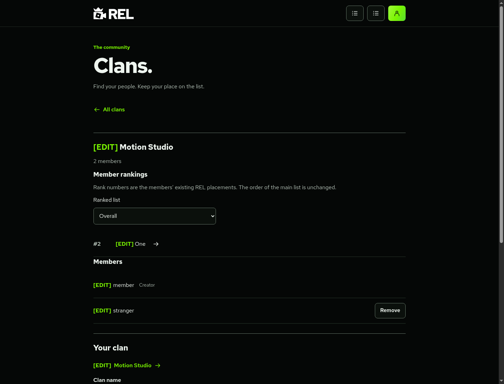
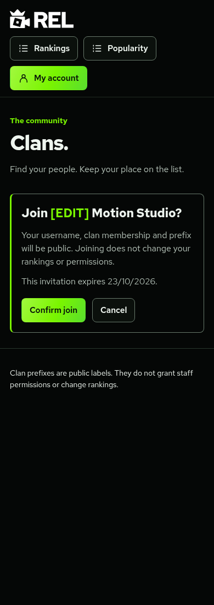

# Clans and member prefixes

Clans are public groups of REL accounts. Any active, confirmed member can create one; accounts can belong to **one clan at a time**. Ranked and unranked accounts can join. Clans do not claim editor profiles, grant permissions or change rankings.

## Workflow

1. Open **Clans** from rankings, the homepage or My account. Sign in with a confirmed REL account.
2. Choose a name of 3–50 characters and exactly **four letters or numbers** for the prefix. Letters are stored uppercase. Names are unique without regard to case; prefixes are unique. Members display as **`[ABCD] name`** on public profiles, ranked editor tiles, clan pages and Popularity rows. Ranking JSON names are not rewritten.
3. The creator can edit the name/prefix. Membership resolves to its current prefix on new page/API loads, applying changes to all members without editing their account records. Already-open pages may need reloading.
4. **Create invite link** returns a private, reusable seven-day invitation. Replacing invalidates the previous link; revoking stops it immediately. The 32-byte random token appears in the creator's current page and shared URL fragment (`#invite=…`). Only its SHA-256 hash is stored. Tokens are absent from API URLs, the directory and audit details.
5. Opening the link previews the clan without joining. Recipients **Cancel**, or sign in and then **Confirm join**. Sign-in returns to this fixed REL route and still requires confirmation. New users confirm their email and reopen the invitation. Arbitrary external redirects are not accepted.
6. Members can leave. Creators can remove members, rotate/revoke invites or disband. The creator cannot remove themselves or leave an ownerless clan; they must disband. Disbanding deletes the clan, invites and memberships, removing all prefixes. Ownership transfer is outside this first version.

Confirmation states that membership, username and prefix are public. Each member links to their REL account profile. Disabled, anonymous, unconfirmed or banned accounts are hidden. Clans with inactive creators are hidden and cannot accept invitations; existing members can still leave through **Your clan** on the directory. Private email and staff roles are not published.

## Clan rankings

Clan pages default to Overall and number their linked ranked editors **#1, #2, #3 within the clan**, following the overall list's order. For example, members at #4, #12 and #27 overall appear as #1, #2 and #3 in their clan. Selecting an existing style list follows that style's order and starts the clan positions at #1 again. Overall and style rank numbers are not displayed in the clan ranking rows or written back to the saved lists. Unranked accounts remain in the member list. An account needs an editor link, through verified matching or Owner review, to appear in member rankings.

Popularity keeps audience ordering and snapshot dates; the clan prefix is only a label. Clan changes preserve `data.js`, saved ranks and permissions.

## Protection

[`20261016200000_rel_clans.sql`](../supabase/migrations/20261016200000_rel_clans.sql) adds private clan, membership and invitation-hash tables with RLS and no direct browser grants. Mutations require a live confirmed REL session, same-origin POST and database checks. A single-membership primary key and existing advisory lock protect competing creates/joins.

Only the creator updates a clan, issues invites, removes members or disbands. Staff do not automatically become another clan's creator. Service-only public projections include names, usernames, public account profile IDs, linked editor IDs and prefixes, excluding emails, staff roles, provider secrets and invite hashes. Preview uses POST to keep raw tokens out of endpoint URLs.

Creation is limited to three/account/day; links to ten/account/hour. Invites are reusable while valid. Audit records actor, time, action, clan ID and removed-member ID where applicable, without invitation tokens/hashes. Disbanding retains minimal audit entries.

## Setup and checks

The migration requires existing accounts/usernames and public profiles. On this combined branch, review missing social migrations in [Popularity setup](POPULARITY.md), then apply the clan migration last. Do not rerun installed migrations or reset data. Production SQL, merging and deployment need separate Owner approval; none were performed here.

No bot, paid dependency, new credential or scheduled clan service is required. Existing Cloudflare/Supabase free allowances apply. Creator support/moderation, ownership transfer and history exports can be considered separately.

```sh
npm test
npm run build
npm run check:cloudflare
REL_FIXTURE_TIKTOK=1 REL_FIXTURE_YOUTUBE=1 npm run test:preview
```

`tests/clans.test.mjs` covers validation, explicit joining, expired/revoked/replaced links, creator permissions, single membership, leave/removal/disband, private access, CSRF, revoked sessions and ranking/account/audit preservation.

With local Chromium DevTools on port 9223, run `tests/popularity-browser-review.mjs` then `tests/clans-browser-review.mjs` on the same fresh fixture. The latter uses the former's fictional count for the Popularity prefix check. Run the existing browser regression separately on a fresh fixture because it edits fictional passwords/rankings. Font variables follow the existing browser guide. Fixture tests do not establish provider approval or live configuration.

Actual local screenshots below use fictional accounts and a **Motion Studio** test clan, not production memberships:




