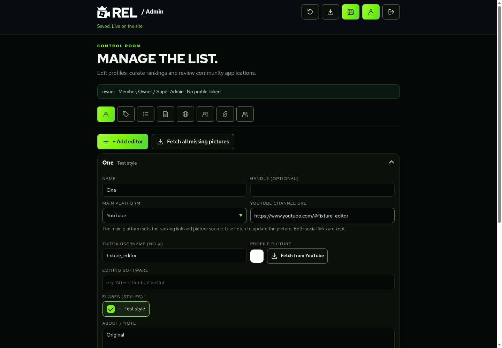
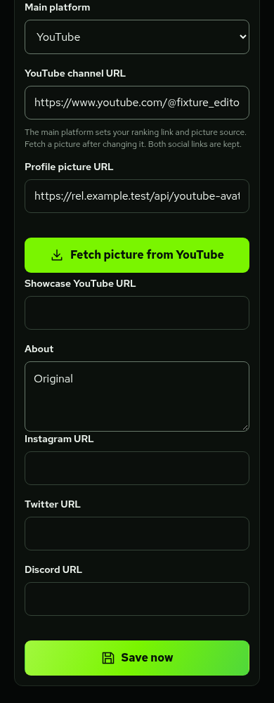

# Editor main platforms and pictures

Each editor can choose **TikTok** or **YouTube** in **My account** once an Owner has linked their REL account to that editor. Owners and List Contributors can edit the same setting for every editor in **Admin → Editors**. No account is needed for an editor to have a main-platform setting managed by staff.

1. Enter the TikTok username and/or YouTube channel URL.
2. Choose **Main platform**. This sets the destination of the editor's ranking name, avatar and handle links. The separate profile button still opens the REL profile.
3. Select **Fetch from TikTok/YouTube** to update the picture. Changing the platform alone keeps the current picture until a new one is fetched. A manual picture URL remains available.

Both social links stay on the REL profile; the chosen platform appears first. A failed lookup keeps the existing picture. If the platform, account link or picture field changes during a fetch, its result is discarded instead of replacing the newer choice. Bulk missing-picture and legacy-picture replacement actions use each editor's chosen platform.

These are local development previews with fictional accounts and a synthetic image, rather than live rankings:

Old editors do not need a data rewrite: a valid TikTok account remains the default; otherwise a valid YouTube-only channel defaults to YouTube. An explicit `main_platform` choice wins. New profiles converted from applications record the submitted platform. No migration seeds editors or rewrites ranking JSON.

## Setup before release

Review and apply [`20261016160000_rel_editor_main_platform.sql`](../supabase/migrations/20261016160000_rel_editor_main_platform.sql) only with the database owner's approval. It requires the existing account and application-review setup. It updates profile validation and application conversion, preserving the same roles, revision checks, ranking protection and history. It can be reapplied without changing existing records. Apply it before releasing the updated account form: older validators reject the new field.

YouTube pictures need **YouTube Data API v3** enabled in a Google Cloud project and a server-only `REL_YOUTUBE_API_KEY` binding in Cloudflare Pages. Restrict the key to YouTube Data API v3. The same Google project as a future Google authorisation integration can be used, but an OAuth client ID/secret is not an API key. Do not place this key in browser JavaScript, Git or this cloud development environment. The checked-in template contains an empty field only.

The lookup uses `channels.list` with `forHandle`, `id` or `forUsername`, costing one quota unit per lookup. Supported links:

- `https://www.youtube.com/@handle`
- `https://www.youtube.com/channel/UC…` with the full channel ID
- `https://www.youtube.com/user/legacyusername`

An old `/c/name` custom link can be used as the ranking destination; picture fetching asks for the channel's current @handle or channel-ID URL. Video, Shorts and shortened video links are not channel links.

TikTok fetching continues to read the public profile and copy its picture into Supabase's public `editor-avatars` bucket. TikTok sometimes blocks server requests; paste a picture URL when that happens.

TikTok image downloads and Storage uploads use Cloudflare's supported manual redirect mode and reject non-success responses. Image and upload redirects are not followed. The runtime regression uses synthetic profile HTML, image bytes and Storage responses to check the complete authenticated fetch, redirect rejection, size/type checks and permission failures without contacting production services.

YouTube pictures use a stable HTTPS REL URL at `/api/youtube-avatar?channel=UC…`. On a cache miss, this route refreshes the picture through Google's API. The image cache lasts at most one day at each Cloudflare location, and browsers cache it for one hour. No permanent copy of the YouTube thumbnail or Google API response is stored in Supabase. Public cache misses are limited to channel IDs referenced by an editor's saved picture URL; the public route cannot query arbitrary channel IDs. Fetching an unsaved profile is authenticated and warms the same cache.

Google's default quota allows free use within its limits. An initial picture fetch needs one channel lookup; later cache misses need another per channel and Cloudflare location. This is not an unlimited-use guarantee. Provider quota failures show an error; public image failures fall back to the editor's initial. Monitor Google quota before increasing traffic. This feature adds no paid service or deployment.

Fetching a public picture does **not** verify ownership of a YouTube or TikTok account, link a REL account, grant a role or affect rank. Google account authorisation, application tracking and email changes remain in their separate feature branch. TikTok verification and clans remain deferred.

Official references: [channels.list](https://developers.google.com/youtube/v3/docs/channels/list), [quota costs](https://developers.google.com/youtube/v3/determine_quota_cost), [YouTube developer policies](https://developers.google.com/youtube/terms/developer-policies).

## Development checks

`npm test`, `npm run build` and `npm run check:cloudflare` cover the feature without production services. The fixture intercepts Google and TikTok requests and uses a tiny synthetic PNG. No genuine API key, external account or production database is involved.

`node --test --test-isolation=none tests/avatar-runtime.test.mjs` checks the TikTok image download and upload in the actual local Cloudflare runtime. Standard Node fetch mocks do not reproduce Cloudflare rejecting `redirect: "error"` before a request is sent.

`node --test --test-isolation=none tests/editor-platform.test.mjs` shows the individual platform, migration, permission, conversion, image-validation and caching cases. The focused browser review is `node tests/platform-browser-review.mjs` with the fixture and Chromium DevTools running as described in the development guide. Its local HTTP fixture substitutes an HTTPS image URL in the response because production picture fields require HTTPS. Real Google availability, live key restrictions and Cloudflare's cache expiry require release-environment verification.
