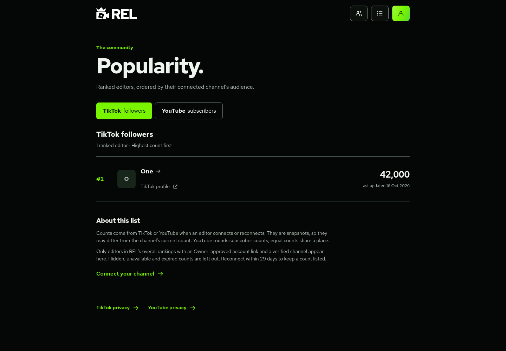
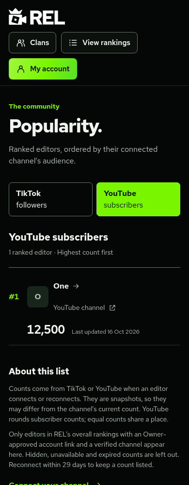

# Ranked-editor Popularity

`/popularity/` has separate **TikTok followers** and **YouTube subscribers** lists. Official account-authorisation APIs supply counts when a member connects or reconnects and confirms the returned account. No scraping, bio codes, paid bot or combined audience total is used.

This review branch starts from fetched `main` (`4ad2c76`). It carries forward the approved TikTok prerequisite and extracts YouTube connection files from `feat/application-tracking`. Application tracking/emails and the main-platform/avatar work remain separate. Existing editor pictures are used here, with initials when unavailable.

## Eligibility and ordering

An account must be active, email-confirmed and non-anonymous, with an **Owner-approved editor link** pointing to an editor currently in the overall rankings (`lists.main`). It needs a confirmed TikTok or YouTube connection with a known public count. Removed editors, unlinked/disabled/banned accounts, hidden/missing counts and expired snapshots are excluded on each request. Connecting a channel does not claim a ranked profile or grant permissions.

Counts sort highest first. Equal counts share a place, with stable editor-ID ordering within ties. Real zeros are included. YouTube rounds counts down to three significant figures; equal subscriber counts need not represent equal exact audiences. Platforms are never added together.

Each row links to the REL editor profile and verified channel, with the snapshot's **Last updated** date. Editing-skill placements, ranking JSON and `data.js` are preserved.

## Confirmation and data

- TikTok requires `user.info.basic` and `user.info.profile`, and requests optional `user.info.stats`. Only `follower_count` is requested from the statistics fields. Declining statistics still permits an ownership connection without a Popularity entry. Temporary access is revoked before staging proof; no TikTok access/refresh tokens are retained.
- YouTube uses Google OAuth with PKCE and `youtube.readonly`. The callback reads owned channels with `mine=true` and `part=snippet,statistics`; the member selects a channel explicitly. Hidden counts are excluded. An AES-GCM encrypted refresh credential stays private for channel-access checks. No Google email or password is read.
- Confirmation screens show the count and explain publication for eligible ranked editors. Browser-supplied counts, account IDs and dates cannot replace the staged provider result. A service-only RPC binds counts to the consumed challenge, and a trigger copies them only into its confirmed connection.
- Counts are snapshots from connection/reconnection. YouTube access/metadata maintenance never refreshes counts or their dates. Reconnect to update a count. Existing connections without statistics need reconnection; nothing is guessed or backfilled.
- Counts stop appearing after 29 days; maintenance deletes expired snapshots. Disconnect immediately removes the count with the connection. Revoked YouTube access is removed when detected. TikTok's dated proof expires or is disconnected, since temporary provider access has already been revoked.
- Private tables have RLS and no direct browser grants. The public list returns editor ID/name/picture, canonical channel URL, count, place and observation time only. Emails, roles, account UUIDs, provider IDs, sessions and credentials are excluded.

Public notices: [TikTok](../tiktok-privacy/index.html), [YouTube](../youtube-privacy/index.html). The Owner-approved privacy contact is `shaun@seeshaun.xyz`.

## Before activation

No deployment, production SQL or production credentials have been configured by this work. Obtain separate Owner approval before those actions.
The user also requested clans on this review branch. After the social migrations below, review and apply the missing [`20261016200000_rel_clans.sql`](../supabase/migrations/20261016200000_rel_clans.sql). The public profile and Popularity APIs now include a public clan summary; [clan setup](CLANS.md) describes its independent protections and display-only prefixes.

1. Confirm existing account, username, public-profile and contributor-tier migrations. Review and apply **missing** migrations in timestamp order: [`20261016130000_rel_youtube_connections.sql`](../supabase/migrations/20261016130000_rel_youtube_connections.sql), [`20261016180000_rel_tiktok_connections.sql`](../supabase/migrations/20261016180000_rel_tiktok_connections.sql), then [`20261016190000_rel_editor_popularity.sql`](../supabase/migrations/20261016190000_rel_editor_popularity.sql). Do not rerun installed one-time migrations, drop records or reset rankings. The YouTube schema matches the earlier draft; its header now reflects that application tracking is not a prerequisite.
2. Configure TikTok Login Kit Web and complete applicable review for all three scopes, including `user.info.stats`. Register the intended origin's exact HTTPS callback `/api/account/tiktok/callback`. [TikTok setup](TIKTOK_CONNECTION.md).
3. Configure Google OAuth Web and YouTube Data API v3. Register the intended origin's exact HTTPS callback `/api/account/youtube/callback`. Configure owned-domain, public consent, privacy/terms information and approved test users. Request only `youtube.readonly`; complete Google's applicable sensitive-scope/app verification for public use. Testing mode can restrict users and expire refresh credentials. This connects YouTube; it does not sign into REL.
4. In the intended Pages environment only, configure the optional names in `.dev.vars.example`: TikTok's three bindings, plus `REL_GOOGLE_CLIENT_ID`, `REL_GOOGLE_CLIENT_SECRET`, `REL_GOOGLE_TOKEN_KEY` (base64-encoded 32 random bytes), and `REL_YOUTUBE_REDIRECT_URI`. Retain the dedicated encryption key securely for existing encrypted connections. Real values do not belong in Git, chat or this cloud workspace.
5. Separately approve deployment of [`wrangler.social-maintenance.jsonc`](../wrangler.social-maintenance.jsonc). Bind `SUPABASE_URL`, `SUPABASE_SERVICE_ROLE_KEY`, `REL_GOOGLE_CLIENT_ID`, `REL_GOOGLE_CLIENT_SECRET` and `REL_GOOGLE_TOKEN_KEY` for the intended environment. No TikTok credentials are needed. The hourly cron removes expired TikTok proofs, rechecks up to five due YouTube connections, and removes expired counts. Use this combined worker instead of also running standalone TikTok cleanup. Pages does not deploy it automatically; its HTTP endpoint returns 404.
6. Verify the cron before public activation. YouTube connections unchecked for two days are hidden; unchecked for 29 days are removed. Five checks/hour supports about 120 channel checks/day: monitor backlog before expansion. Counts independently expire after 29 days, even with recent access checks.
7. Use approved test users to verify actual provider consent, optional TikTok scope denial, Google channel selection, revocation/removal and cron execution. Local fixtures cannot prove provider approval or real scheduled execution. Coordinate website release after reviewing SQL and configuration.

No paid dependency or paid API subscription was added. Requests consume existing Cloudflare/Supabase free allowances and YouTube quota. Provider approval and limits apply; unlimited free operation is not promised.

## Development and previews

```sh
npm install
npm test
npm run build
npm run check:cloudflare
REL_FIXTURE_TIKTOK=1 REL_FIXTURE_YOUTUBE=1 npm run test:preview
```

The fixture uses fictional accounts, provider API responses and a local Postgres-compatible database. It sends no email and cannot contact production. HTTP callbacks exist solely for the provider stand-in; real providers need registered HTTPS origins.

`tests/popularity.test.mjs` covers confirmation, optional/malformed/hidden/zero counts, eligibility, ties, sorting, revoked/expired records, unchanged snapshot dates, private permissions and preservation of rankings/accounts/audit. The connection suites cover state, cookies, PKCE, session/replay binding, unique-channel protection, revocation and provider failures.

With Chromium DevTools on loopback port 9223, run `node tests/popularity-browser-review.mjs` against a fresh fixture. It intercepts provider consent screens with labelled local stand-ins and checks actual browser redirects/cookies, confirmation, navigation and account controls. Optional font variables match `tests/browser-review.mjs`. Run the existing browser suite on another fresh fixture because it intentionally edits fictional rankings/passwords.

These are actual local UI captures with fictional ranked editor **One** and fixture counts, not real audience claims:





## Combining other review branches

PR #7's TikTok prerequisite is included here. PR #5's YouTube-only files are included; its application/email feature is not. Preserve both connection sections, public fields, privacy pages and fixture flags when combining that branch. PR #6's platform/avatar feature still needs reconciliation with shared profile and fixture files. Do not deploy independent branches over one another. No branch has been merged by this work.

Official references checked 16 October 2026: [TikTok user-info fields/scopes](https://developers.tiktok.com/doc/tiktok-api-v2-get-user-info/), [YouTube channel statistics and rounding](https://developers.google.com/youtube/v3/docs/channels#statistics), [YouTube API data policies](https://developers.google.com/youtube/terms/developer-policies).
