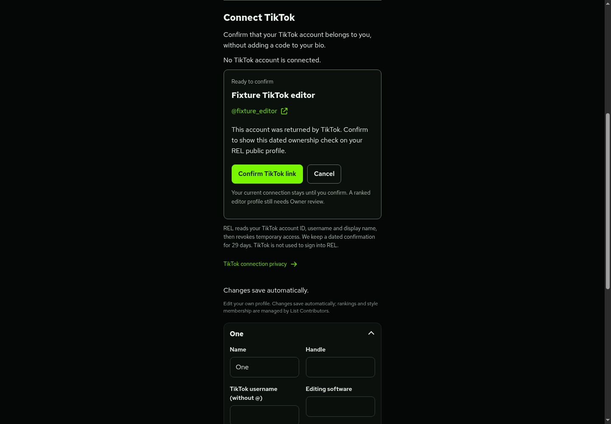
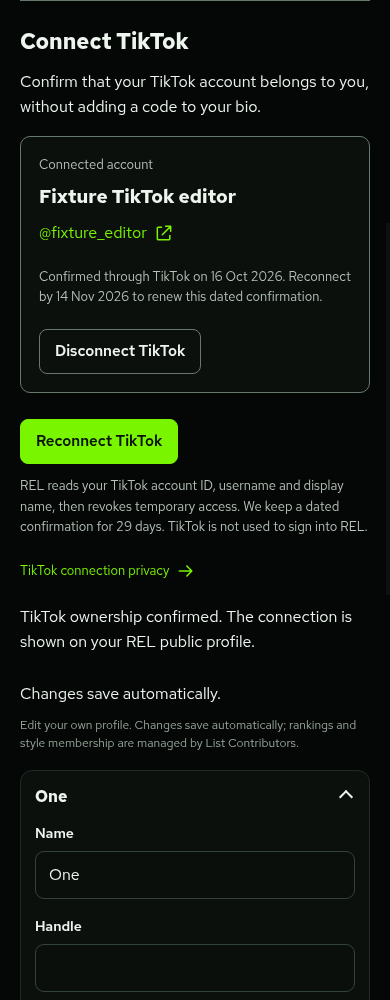

# Connect and verify TikTok

This feature connects a TikTok account to an existing, email-confirmed REL account. It does **not** add TikTok sign-in or signup, change passwords, grant roles, claim a ranked editor profile or change rankings. Owner-reviewed editor linking remains available.

## What a member sees

1. Open **My account → Connect TikTok**.
2. TikTok handles sign-in and asks permission to share the account's basic/profile information.
3. REL reads the authorised account's ID, username and display name, then revokes temporary access. No bio code is needed.
4. My account shows the returned account. **Confirm TikTok link** publishes a dated ownership confirmation on the REL public profile. **Cancel** keeps the existing connection.
5. **Disconnect TikTok** removes the connection and pending proof. Reconnecting uses a new TikTok authorisation and explicit confirmation.

The confirmation lasts **29 days**, which is REL's chosen retention period. It confirms control on the displayed date, rather than continuously monitoring ownership or representing TikTok's blue verification badge. Reconnect after changing a TikTok username. Expired confirmations disappear from public results immediately; the hourly cleanup removes their private metadata. No TikTok access or refresh token is retained for background access.

This branch starts from `main` at `4ad2c76`. It has not been merged, deployed or applied to a production database. Application tracking/Google connections and main-platform/avatar work remain in their separate review branches.

## Before public activation

These are release prerequisites, not actions already performed:

1. Review the one-time migration [`20261016180000_rel_tiktok_connections.sql`](../supabase/migrations/20261016180000_rel_tiktok_connections.sql). Obtain separate approval before applying it to production. It requires the existing account and public-profile setup. It adds private connection/challenge tables and functions, without replacing ranking JSON, accounts, applications, existing editor links or `data.js`. Do not rerun it over an installed copy or drop existing data to make it run.
2. Register REL in the [TikTok developer portal](https://developers.tiktok.com/), configure Login Kit for Web, and request **`user.info.basic`** and **`user.info.profile`**. The latter is needed to get the actual username; a basic display name alone is not used to identify a profile. Complete the portal's applicable product/scope review for `/v2/user/info/`. REL requests neither video-list/posting permissions nor follower/like statistics. Start with the provider's supported sandbox/test users. Public use requires TikTok's approval; this code cannot bypass it.
3. Register the exact static HTTPS callback: **`https://robloxeditors.com/api/account/tiktok/callback`**. Configure REL's owned domain, support contact and public privacy/terms information, including `/tiktok-privacy/`. A fixed staging host needs its own registered callback and test settings. TikTok's real Web Login Kit requires HTTPS; random preview domains and local HTTP callbacks cannot borrow the production callback.
4. Set `REL_TIKTOK_CLIENT_KEY`, `REL_TIKTOK_CLIENT_SECRET` and `REL_TIKTOK_REDIRECT_URI` securely in the intended Cloudflare Pages environment. The client secret stays server-side. The checked-in `.dev.vars.example` adds empty optional names only. Do not add production credentials to Git, chat or this cloud workspace. No encryption-key binding is needed because no provider tokens are stored.
5. Separately approve and deploy [`wrangler.tiktok-cleanup.jsonc`](../wrangler.tiktok-cleanup.jsonc). Bind `SUPABASE_URL` and `SUPABASE_SERVICE_ROLE_KEY` for the intended database to that worker. It needs no TikTok credentials and performs only expired-proof cleanup through a service-only RPC. Pages deployment does not deploy it automatically. Its HTTP handler always returns 404. Verify its hourly cron before enabling the website connection.
6. Coordinate the website release after SQL and cleanup are ready, and obtain approval before merging/deploying. Missing TikTok settings show an unavailable message and leave manual linking available. Missing schema produces an error rather than a fabricated empty connection. With separately approved test accounts, verify actual TikTok consent, returned username, revocation, same-session confirmation and public removal.

This integration adds no paid dependency, scraping service or browser automation service. TikTok approval and provider limits still apply. Each successful verification uses token exchange, user-info lookup and token revocation; there are no continuing TikTok API polls. The cleanup worker shares the existing Cloudflare/Supabase free allowances. A local test is not evidence of live provider approval or real cron operation.

## Connection protection and stored data

Starts require a confirmed active REL session and same-origin POST. A 32-random-byte state is stored only as a SHA-256 hash in the private challenge. The raw state is in a ten-minute HttpOnly SameSite=Lax cookie and the provider redirect. The callback must match it before claiming the challenge once. Database checks reject expired/replayed state, revoked sessions, disabled/banned accounts and anonymous/unconfirmed users before token exchange.

This is TikTok's documented confidential Web Login Kit flow, authenticated by the server-side client secret. Its current web guide does not specify the mobile/desktop PKCE parameters, so this implementation does not pretend that an undocumented web PKCE exchange has been verified. Random state, a browser cookie, single-use storage and same-REL-session confirmation protect the web flow.

The server checks the granted scopes and requires the token's `open_id` to match `/v2/user/info/`. Provider requests use fixed HTTPS endpoints, reject redirects, time out and bound JSON to 64 KiB. Proof is staged only after revocation succeeds. Token/info/identity/scope/revocation failures do not create a new connection. A failed revoke cannot be truthfully reported as successful: the error flow explains that remaining REL permission can be removed in TikTok's settings. Credentials are discarded rather than saved for retries.

The callback redirects to a fixed My account status, with no code/token/state in the destination URL. It stages proof, rather than linking automatically. A separate HttpOnly SameSite=Strict finish cookie and an authenticated same-origin POST confirm the account in the initiating REL session. Existing REL login cookies remain Strict and no new REL session is created. A forged user ID, username or TikTok ID in the confirmation body is ignored; the database uses the staged proof.

A TikTok `open_id` is unique across active REL connections. It cannot silently replace another account's connection. A conflict leaves both existing records intact. Starts are limited to five per REL account/hour, with a one-minute cooldown for an outstanding attempt. Cancel only removes the current session's pending attempt; disconnect removes the authenticated member's connection and pending attempt.

Private storage contains the REL account/session association, state/confirmation hashes and short-lived proof; the confirmed record contains the TikTok ID, username, display name, confirmation and expiry times. It has RLS enabled and no direct browser roles can access it. Callback/cleanup/public-projection RPCs are service-only. Member-facing status removes the TikTok ID and challenge hashes. Public profiles show only username, display name and confirmation/expiry dates for active confirmed accounts.

Audit entries retain the REL actor, actor username, time and action without TikTok tokens, code, ID or display metadata. Disconnect and expiry cleanup remove TikTok connection data; existing database backups and the minimal REL audit trail follow the operator's separate retention process. The [public notice](../tiktok-privacy/index.html) uses the owner's approved privacy contact, `shaun@seeshaun.xyz`.

## Development checks and previews

```sh
npm test
npm run build
npm run check:cloudflare
node --test --test-isolation=none tests/tiktok-connection.test.mjs
WRANGLER_LOG_PATH=/tmp/rel-tiktok-dry-run.log npx wrangler deploy --dry-run --config wrangler.tiktok-cleanup.jsonc --outdir .wrangler/tiktok-cleanup-check
```

The local preview can enable a fictional TikTok provider:

```sh
REL_FIXTURE_TIKTOK=1 npm run test:preview
```

With Chromium DevTools on port 9223, run `node tests/tiktok-browser-review.mjs`. The script intercepts TikTok's authorisation page with an explicitly labelled local stand-in; real browser navigation/cookies then return to the local callback. Backend token/user/revoke responses and the database are fixtures. Local HTTP callback support exists for this stand-in only; it does not mean TikTok will register a real HTTP callback. The optional local-font environment variables are the same as the existing browser review.

The review covers empty/confirmation/connected/error/cancelled states, keyboard confirmation, public display, reconnect/cancel, disconnect, provider denial, error retry and 320/390/768/1440px layouts. SQL/API tests cover roles, exact identity matching, conflict preservation, state/replay/session/expiry checks, scopes/provider failures, revocation before proof, private projections, cleanup and unchanged rankings. Live provider approval, real consent/revocation and scheduled production cleanup remain untested prerequisites.

The screenshots below are actual local development views with fictional accounts:





## Combining review branches

This feature deliberately leaves REL sign-in unchanged. When integrating with the Google/application branch, retain both connection sections and public profile fields, the static output for both privacy pages and each feature's fixture options. The shared account markup, public-profile renderer and mock fixture will need a reviewed reconciliation. The independent main-platform branch also edits the profile renderer/fixture; preserve its link choice and avatar paths. Do not deploy one branch over another without that review.

Official references checked 16 October 2026: [Web Login Kit](https://developers.tiktok.com/doc/login-kit-web/), [token exchange/revocation](https://developers.tiktok.com/doc/oauth-user-access-token-management/), [user fields/scopes](https://developers.tiktok.com/doc/tiktok-api-v2-get-user-info/), [developer guidelines](https://developers.tiktok.com/doc/our-guidelines-developer-guidelines/).
